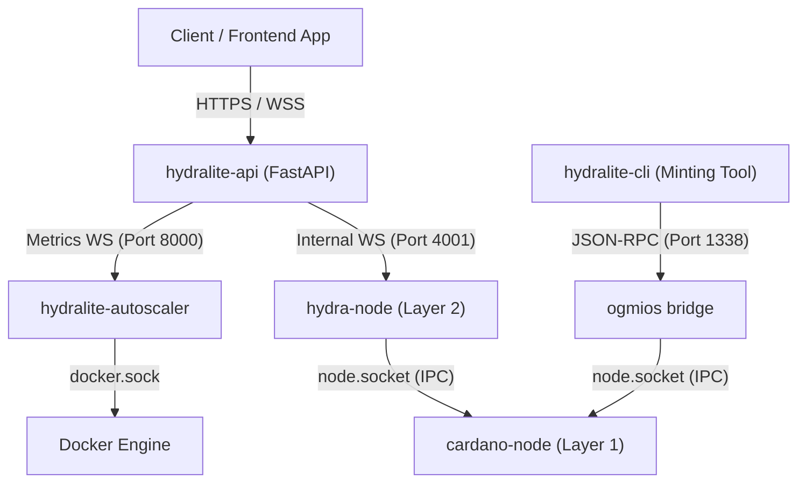
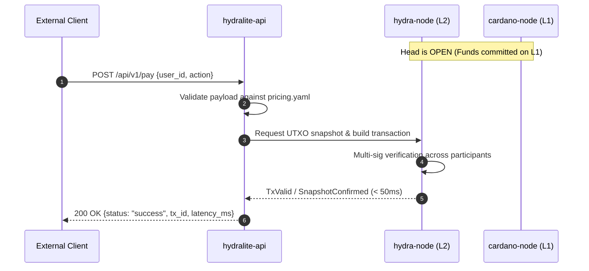
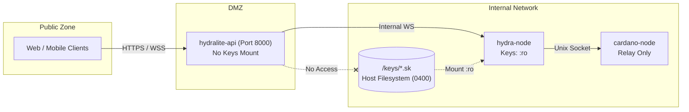

# System Architecture

This document describes the architectural design, component interactions, transaction lifecycle, and operational boundaries of HydraLite v1.0.0.

---

## Background & Design Goals

Cardano Layer 1 operates on Ouroboros Praos consensus with an average block time of 20 seconds and a maximum block body size of approximately 88 KB. While this provides strong decentralization and formal security for settlement, high-frequency use cases (such as micro-payments, high-volume NFT minting batches, and real-time game interactions) face throughput bottlenecks and linear transaction fee accumulation if every state transition is committed directly to Layer 1.

Hydra is Cardano's isomorphic state channel framework. It allows a set of known participants to lock funds into an on-chain contract (the "Head"), execute arbitrarily many off-chain transactions using standard Cardano ledger rules (Plutus scripts, datum, and UTXOs), and finalize the net outcome back to Layer 1 in a single transaction.

HydraLite abstracts the operational complexity of managing state channel lifecycles, key management, and WebSocket protocol communication behind a standard REST and WebSocket middleware.

---

## High-Level Topology

The system runs as an isolated multi-container stack orchestrated via Docker Compose:

---

## Component Breakdown

### 1. `cardano-node` (Layer 1)
- **Image**: `ghcr.io/intersectmbo/cardano-node:10.5.4`
- **Role**: Maintains synchronization with the Cardano ledger. Exposes a Unix domain socket at `/ipc/node.socket` for local client communication.
- **Data Volume**: `./node-db` mapped to `/data/db`. Requires persistent SSD storage.

### 2. `mithril-client` (Bootstrap Utility)
- **Image**: `ghcr.io/input-output-hk/mithril-client:latest`
- **Role**: Downloads cryptographically certified state snapshots from the Mithril network. This bypasses the need to validate historical blocks from genesis, reducing initial node synchronization from days to under 30 minutes. Run once during initial host provisioning via `docker compose --profile init`.

### 3. `ogmios` (IPC Bridge)
- **Image**: `cardanosolutions/ogmios:latest`
- **Role**: Connects to `/ipc/node.socket` and translates the Haskell binary mini-protocols (LocalTxSubmission, LocalStateQuery, ChainSync) into JSON-WSP and WebSockets on port `1338`. Used primarily by the CLI tool for building and inspecting raw L1 transactions.

### 4. `hydra-node` (Layer 2 State Engine)
- **Image**: `ghcr.io/cardano-scaling/hydra-node:1.2.0`
- **Role**: Executes the off-chain state channel consensus. Maintains peer-to-peer state channels with other head participants over port `5001`.
- **Key Access**: Mounts `./keys/hydra.sk` and `./keys/cardano.sk` strictly in read-only mode (`:ro`).
- **Admin Interface**: Listens on port `4001`. **Must not be exposed publicly**; accessible only internally by `hydralite-api`.

### 5. `hydralite-api` (Application Middleware)
- **Image**: `ghcr.io/kwired/hydralite:v1.0.0@sha256:6b59e09ddb50cce2849d638050ecb16eac4a9f15106869a23a671c5f24a3e6c2`
- **Role**: FastAPI asynchronous service. Exposes public REST endpoints (`/pay`, `/verify`) and WebSocket streams (`/ws/metrics`, `/ws/gaming/{id}`).
- **Security Boundary**: Contains **zero cryptographic keys**. All transaction signing requests are formatted and passed directly to the internal Hydra daemon.

### 6. `hydralite-autoscaler` (Load Supervisor)
- **Image**: Same audited release image running `autoscaler/monitor.py`.
- **Role**: Subscribes to the live metrics stream. When throughput exceeds 800 TPS or head load surpasses 80% for more than 5 consecutive sampling windows, it interfaces with the Docker socket to spawn a secondary Hydra Head instance.

---

## Transaction Lifecycle

The sequence below illustrates what happens when an application submits a transaction through the API:

1. The client sends a payment or action payload to the FastAPI gateway.
2. The middleware validates the requested action and corresponding Lovelace value defined in `pricing.yaml`.
3. The transaction is formulated against available head UTXOs and submitted to `hydra-node` over the local WebSocket.
4. The Hydra node validates the signature against current snapshot rules and confirms the state transition with connected peers.
5. Confirmation is returned to the caller with sub-50ms round-trip latency. No Layer 1 network fees or block confirmation delays are incurred.

---

## Security Model & Key Isolation

Key isolation rules enforced across the architecture:
- **Zero API Secrets**: The API container cannot access `.skey` or signing key volumes. Even in the event of an API remote code vulnerability, signing keys cannot be dumped from the API environment.
- **Strict Read-Only Mounts**: Signing keys are mounted into the Hydra container with the `:ro` Docker flag. The running container processes cannot overwrite, rotate, or append to key files.
- **Host Permission Hardening**: Key files on the host are restricted to permissions mode `0400` owned by UID `1000:1000`.
