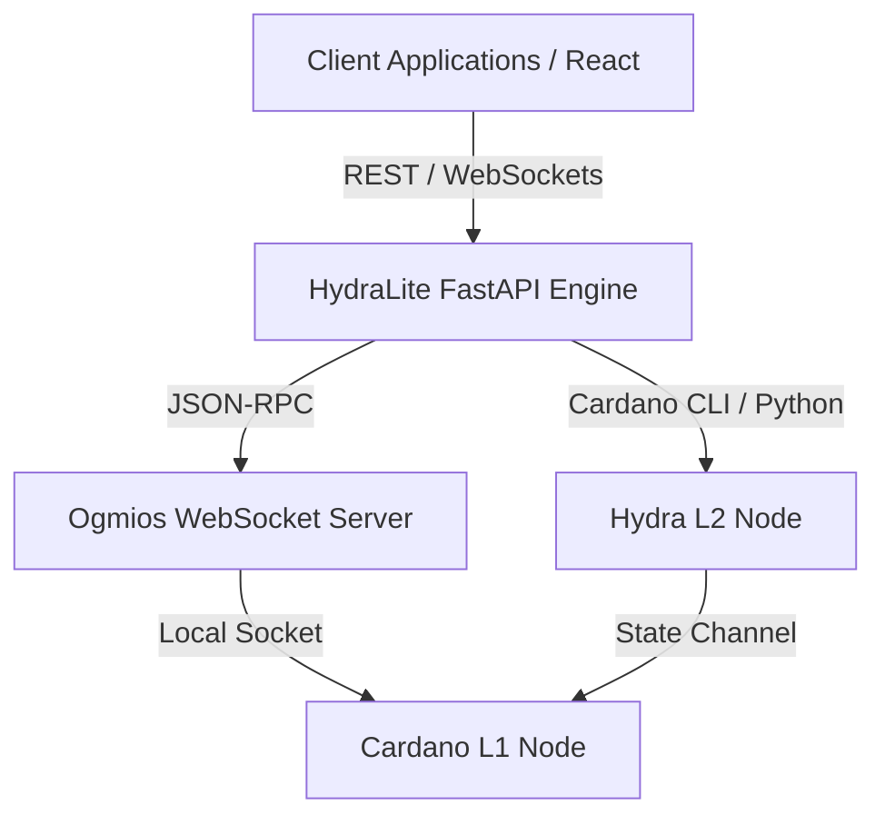
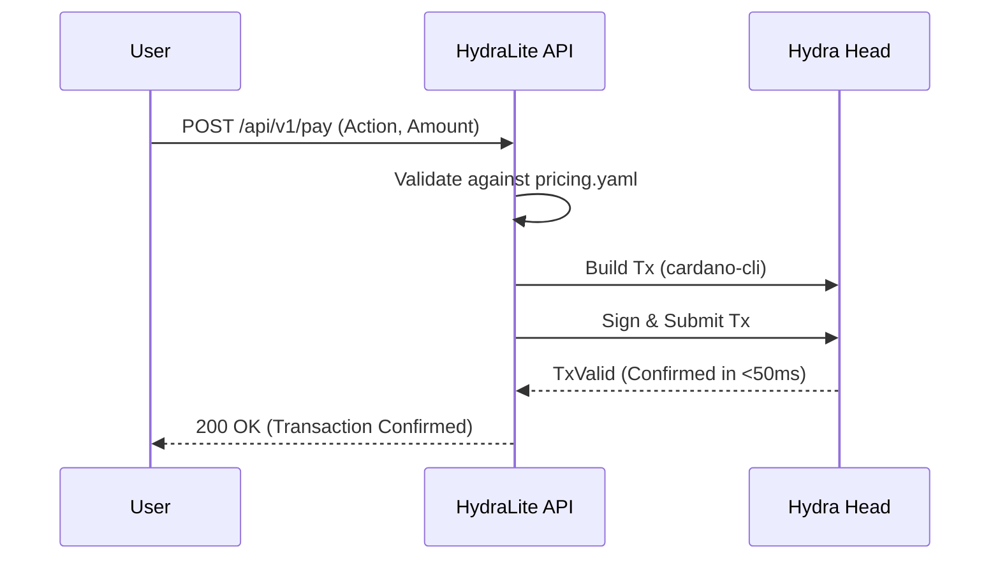
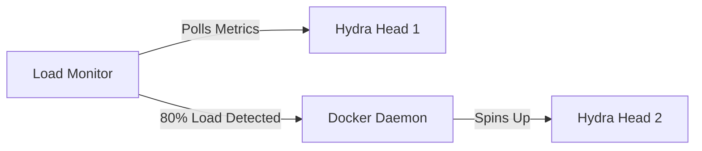

# System Architecture

HydraLite is designed as an ultra-fast, Layer-2 Platform-as-a-Service (PaaS) for the Cardano ecosystem. By abstracting the complex Haskell scripts and UTXO management required to run a Hydra Head, developers can deploy microtransactions, real-time gaming endpoints, and high-frequency NFT mints through a standard REST and WebSocket API.

## High-Level Topology

The system is composed of three distinct layers:
1.  **The Client Layer (Frontend):** A React-based SPA that connects to the HydraLite API.
2.  **The HydraLite Engine (Middleware):** A highly concurrent FastAPI engine that translates REST/WebSocket calls into Cardano UTXO models.
3.  **The Layer 2 Node (Backend):** The `hydra-node` and `cardano-node` connected via the Ogmios protocol.

## Transaction Lifecycle (Micro-PaaS)

When a user initiates a microtransaction through the HydraLite API, the engine utilizes a predefined UTXO "Fuel" strategy to guarantee sub-200ms processing times.

## Auto-Scaling Architecture

HydraLite includes a background monitor that watches the transaction queue of the active Hydra Head. When the Head reaches 80% capacity (configured in `.env`), the Auto-Scaler automatically spins up a secondary Head using Docker to prevent latency spikes.

## Security Model

HydraLite ensures that sensitive Layer-1 keys are never exposed to the public internet. All API requests are authenticated and authorized at the FastAPI middleware layer before interacting with the underlying blockchain nodes.
